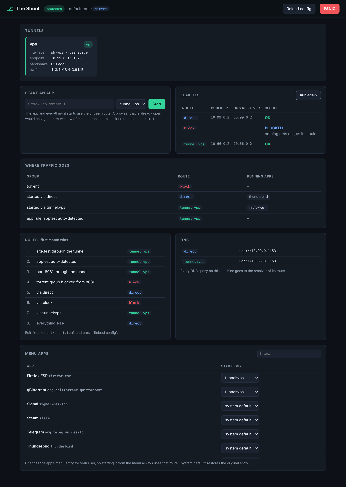

# The Shunt

**Per-app and per-destination split tunneling for WireGuard on Linux.**
Decide which traffic takes which tunnel – by application, IP range or port – with a
kill switch that holds even when the daemon crashes. Open source (Apache-2.0),
no telemetry, no accounts, bring your own WireGuard servers.

> 🇩🇪 *Split-Tunneling pro App, IP und Port für WireGuard unter Linux – fail-closed,
> ohne Telemetrie. Design-Dokument (deutsch): [docs/DESIGN.md](docs/DESIGN.md)*

> ⚠️ **Status: early.** Tested end-to-end in CI (including a real install on a
> systemd host), security-reviewed once, but young. Read [SECURITY.md](SECURITY.md)
> – especially *Known limits* – and try it in a VM before you rely on it.



```console
$ shunt ui                                   # web interface (local only)
$ shunt run --via tunnel:vps -- firefox      # Firefox through the VPS, rest direct
$ shunt run --via direct -- steam            # escape a tunnel default route
$ shunt run --group torrent -- qbittorrent   # use rules from the config
$ shunt status
$ shunt desktop set firefox-esr tunnel:vps   # menu entry always starts through the VPS
$ shunt leaktest                             # public IP + DNS resolver per route
$ shunt panic on                             # drop everything, now
```

## Install (Debian, Ubuntu, Pop!_OS, Kali)

```sh
curl -fsSLo install.sh https://raw.githubusercontent.com/Bob-Nixkoenner/The_Shunt/HEAD/install.sh
less install.sh            # read what you run as root
sudo bash install.sh
```

The installer checks the system, installs `nftables` + `wireguard-tools`, fetches a
verified release (or builds from source), imports your WireGuard config, writes
`/etc/shunt/shunt.toml`, does a dry run and starts the service.
Uninstall: `sudo bash install.sh --uninstall` (`--purge` also deletes `/etc/shunt`).

## What works

- Several WireGuard tunnels at once, each in its own routing table
- Rules by **process group**, **CIDR**, **port** and **domain**, first match wins
- **DNS per route**: each route has its own upstream (Pi-hole, Unbound, AdGuard Home,
  plain/DoT/DoH). Whatever goes through a tunnel is resolved through that tunnel;
  every port-53 query on the machine is caught, DoT is blocked, known DoH hosts
  get NXDOMAIN, EDNS client subnet is stripped
- `shunt run` starts a program inside a route; children inherit it
- **App rules** (`app = ["firefox-esr", "flatpak:org.qbittorrent.qBittorrent"]`): programs
  are moved into their route the moment they start, no wrapper needed (best effort: a
  socket opened in the first milliseconds keeps its old route – use `shunt desktop` or
  `shunt run` where that matters)
- **Menu entries** through a route (`shunt desktop`), race free, per user, reversible
- **Web UI** (`shunt ui`): tunnel health, apps per route, app launcher, menu entries,
  leak test, panic button – local only, token-protected, no external resources
- **Leak test**: public IP and DNS resolver of every route, with verdicts
- **Configure in the UI**: rules (apps, profiles, domains, IPs, ports), DNS servers, default
  route, WireGuard import by drag & drop – every change is checked like `shuntd check`
  before it is written, the old file is kept as `shunt.toml.bak`, and a config that cannot
  be applied is rolled back automatically. A raw TOML editor (keeps comments) is there too.
- **Launchers per profile**: `shunt desktop clone firefox-esr tunnel:vps --name "Firefox SM"
  --args "--new-instance -P sm"`, or one click per Firefox profile in the UI; app rules can
  also match the command line (`args = ["-P sm"]`)
- **Kill switch built into the routing table**: tunnel down, interface deleted or
  daemon stopped → tunnelled traffic gets *unreachable*, never the physical NIC
- **IPv6 strict**: tunnels without IPv6 block IPv6 instead of leaking it
- Panic mode, optional boot lockdown, DDNS endpoint re-resolution
- Kernel WireGuard, with in-process wireguard-go as fallback
- wg-quick files are imported; `PostUp` & co. are **ignored** (no root shell
  hooks from config files you got from somewhere)
- Unprivileged CLI talking JSON over a Unix socket; GUIs can plug in the same way

## How it works

```
shunt run ──► shuntd moves the process into a cgroup (apps/via/tunnel-vps)
                         │
nftables (route hook):  socket cgroupv2 … → meta mark 0x530002  → kernel re-routes
                         │
ip rule fwmark 0x530002 → table 5302:  default dev sh-vps
                                       unreachable default metric 4096  ← kill switch
```

Details, threat model and roadmap: [docs/DESIGN.md](docs/DESIGN.md).

## DNS example

```toml
[dns]
direct = "pihole"                       # direct traffic asks the local Pi-hole

[dns.upstream.pihole]
addr = "192.168.1.2"

[dns.upstream.adguard]                  # AdGuard Home at the end of the tunnel
addr = "https://10.8.0.1/dns-query"
tls_name = "adguard.example.org"

[tunnel.vps]
config = "/etc/shunt/tunnels/vps.conf"
dns = "adguard"                         # default would be DNS= from vps.conf

[[rule]]
name   = "Streaming direct"
domain = ["netflix.com", "nflxvideo.net"]   # covers subdomains
route  = "direct"
```

Domain rules work on the addresses a name resolves to, so other sites on the same CDN
address follow the same route. Apps with their own hard-coded DNS-over-HTTPS bypass
domain rules (app, IP and port rules still apply).

On Pop!_OS/Ubuntu glibc asks systemd-resolved via varlink instead of port 53; the
installer offers `shuntd fix-nsswitch` (reverted on uninstall).

## Manual build

```sh
sudo apt install nftables wireguard-tools   # wireguard-tools only for `wg genkey`
go build -o bin/ ./cmd/shuntd ./cmd/shunt   # Go toolchain is fetched automatically

sudo install -m755 bin/shuntd bin/shunt /usr/local/bin/
sudo install -d -m700 /etc/shunt/tunnels
sudo install -m600 my-vps.conf /etc/shunt/tunnels/vps.conf
sudo install -m644 packaging/shunt.toml.example /etc/shunt/shunt.toml
sudo groupadd --system shunt && sudo usermod -aG shunt "$USER"   # re-login afterwards

sudo shuntd -c /etc/shunt/shunt.toml check  # dry run: validates and prints the nft ruleset

sudo install -m644 packaging/systemd/shuntd.service /etc/systemd/system/
sudo systemctl daemon-reload && sudo systemctl enable --now shuntd
```

Uninstall / emergency exit: `sudo systemctl disable --now shuntd && sudo shuntd cleanup`
(stopping the daemon alone keeps the kill switch active – on purpose).

## Testing

```sh
go test ./...                               # unit tests, golden nft ruleset
sudo ./test/integration/run.sh              # end-to-end in network namespaces
sudo SHUNT_DRIVER=userspace ./test/integration/run.sh
```

The integration test builds a small internet in two network namespaces (WireGuard
server + "whoami" HTTP server) and checks every route, the kill switch, panic mode
and fail-closed behaviour after the daemon stops.

## Security

Short version of [SECURITY.md](SECURITY.md):
- fail-closed everywhere (tunnel down, daemon stopped or crashed, boot)
- the daemon runs with two capabilities (`CAP_NET_ADMIN`, `CAP_CHOWN`) in a
  tight systemd sandbox; the CLI and UI never run as root
- changes need root or polkit (admin password); status, starting apps and
  PANIC never wait for a password
- **per-app routing is not a sandbox** against a program that actively tries
  to get out – for that, route everything through the tunnel

## License

Apache-2.0
